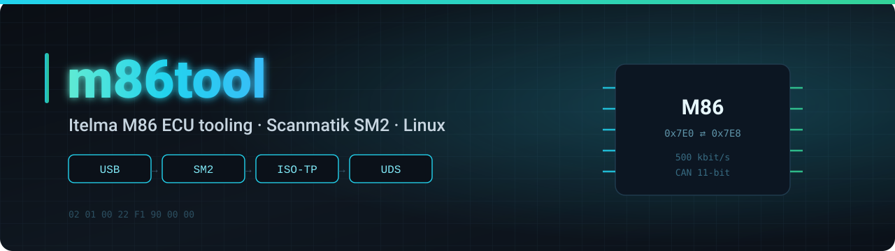
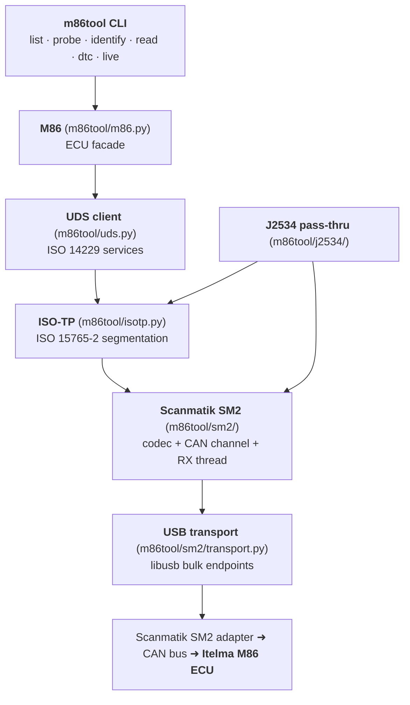
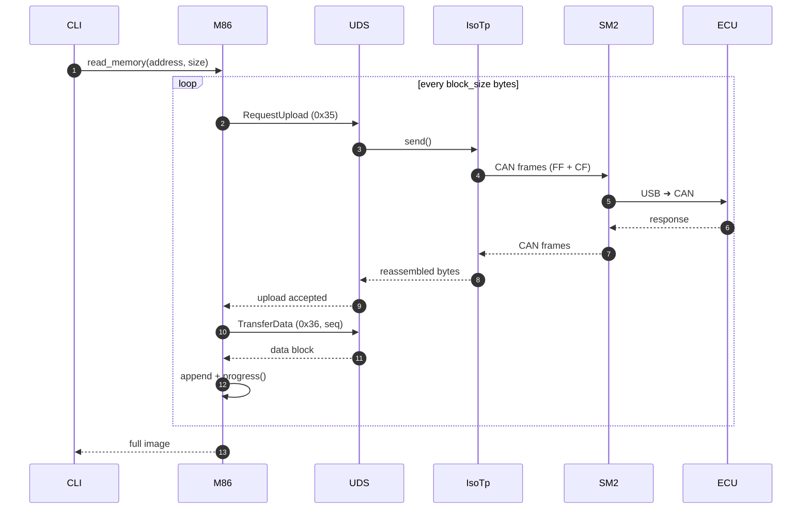
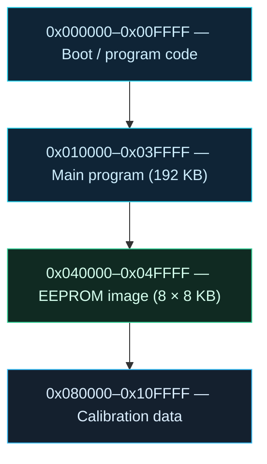

<p align="center">
  
</p>

<p align="center">
  <a href="pyproject.toml"></a>
  <a href="#"></a>
  <a href="#"></a>
  <a href="#"></a>
  <a href="pyproject.toml"></a>
</p>

<h1 align="center">m86tool</h1>

<p align="center">
  <b>Own your Itelma M86 ECU.</b><br>
  Diagnostic and memory tooling over a <b>Scanmatik SM2</b> adapter on Linux —
  no Windows, no proprietary DLLs, pure Python + libusb.
</p>

---

## Overview

`m86tool` talks to the **Itelma M86** engine ECU (found on modern VAZ/LADA
platforms) through a **Scanmatik SM2** USB adapter. It re-implements the whole
stack from the wire up:

- **Scanmatik SM2** USB protocol (reverse-engineered, checksum-checked framing)
- **ISO-TP** (ISO 15765-2) transport over classic CAN
- **UDS** (ISO 14229) diagnostic services
- A high-level **M86** ECU facade (identify, memory read, DTCs, live data)
- A minimal **SAE J2534** pass-thru backend so existing diagnostic apps can
  drive the adapter without any vendor DLL

It runs entirely in userspace via `libusb`, so it works on any Linux box with
the adapter plugged in.

> **Status:** the SM2 *system* commands are confirmed on real hardware. The CAN
> channel command bytes are documented as best-effort and should be re-verified
> against your adapter (see [Probing & verification](#probing--verification)).

---

## Features

| | |
|---|---|
| 🔌 **Adapter discovery** | Enumerate Scanmatik adapters (VID `0x20A2`, PID `0x0001`/`0x0002`) |
| 🧪 **Self-test / probe** | INIT, ECHO, DEVICE_INFO + brute-force command sweep |
| 🪪 **ECU identification** | Read VIN, part number, SW/HW versions, serial over UDS DIDs |
| 💾 **Memory read** | Dump flash / EEPROM / calibration via `RequestUpload` + `TransferData` |
| 🩺 **Diagnostics** | Read and clear DTCs with full status-bit decoding |
| 📈 **Live data** | Poll arbitrary UDS DIDs and watch values change in real time |
| 🧰 **J2534 pass-thru** | Drop-in `PassThru*` API implemented in-process (ctypes-ready) |
| 🐧 **Linux-first** | Pure `libusb` userspace — no kernel driver patches needed |

---

## Architecture

The stack is layered so each piece is testable on its own:



A full memory read fans out into UDS request/transfer pairs per block:



---

## Hardware

| Item | Detail |
|---|---|
| **Adapter** | Scanmatik SM2 / SM2 Pro |
| **USB VID** | `0x20A2` |
| **Known PIDs** | `0x0001` = SM2 Pro, `0x0002` = SM2 (original) |
| **Endpoints** | EP OUT `0x02`, EP IN `0x81` |
| **Bus** | Classic CAN, default **500 kbit/s**, 11-bit IDs |
| **Default UDS IDs** | request `0x7E0`, response `0x7E8` |

The OBD connector normally needs **12 V** present for full operation; INIT will
fail or the adapter stays silent without it.

---

## Installation

Requires **Python ≥ 3.10** and `libusb`.

```bash
git clone https://github.com/Nurmuhammad-Xusanov/M86-tool.git
cd M86-tool

python3 -m venv .venv
.venv/bin/pip install -e .
```

Install the udev rule so the adapter is accessible without root:

```bash
sudo cp udev/52-scanmatik.rules /etc/udev/rules.d/
sudo udevadm control --reload-rules
sudo udevadm trigger
```

After this the CLI entry point is available:

```bash
.venv/bin/m86tool --help
```

---

## Quick start

```bash
# 1. Is the adapter connected and visible?
m86tool list

# 2. Open it and run INIT + ECHO, print device info
m86tool probe

# 3. Read the ECU identification (VIN, part number, versions...)
m86tool identify

# 4. Read the full flash image to a file
m86tool read m86_full.bin

# 5. Read only the EEPROM region
m86tool read m86_eeprom.bin --eeprom

# 6. Read and clear trouble codes
m86tool dtc
m86tool dtc --clear

# 7. Watch live data (VIN DID + a manufacturer DID)
m86tool live F190 F187 --interval 0.5
```

---

## CLI reference

```
m86tool [-v] [--pid 0x0001] [--bitrate 500000] <command> ...
```

Global options:

| Option | Default | Description |
|---|---|---|
| `-v`, `--verbose` | off | Verbose (DEBUG) logging |
| `--pid` | auto | Force the USB PID (`0x0001` / `0x0002`) |
| `--bitrate` | `500000` | CAN bitrate in bit/s |

Commands:

| Command | Arguments | Description |
|---|---|---|
| `list` | — | List connected Scanmatik adapters |
| `probe` | — | Open adapter, run INIT/ECHO, print firmware/HW info |
| `identify` | — | Read M86 identification via UDS DIDs |
| `read` | `<output>` `--address` `--size` `--eeprom` | Read memory to a file |
| `dtc` | `--clear` | Read or clear diagnostic trouble codes |
| `live` | `<did>...` `--interval` `--count` | Poll live-data DIDs |

`read` defaults: `--address 0`, `--size 0x110000` (full flash). `--eeprom` uses
the EEPROM region instead. `live` accepts DIDs as hex (`F190`, `0xF190`).

---

## Python API

The library is importable on its own — the CLI is a thin wrapper.

```python
from m86tool.m86 import M86

m = M86()
m.connect(bitrate=500000)          # bring up SM2 + open CAN

idn = m.identify()
print(idn.vin, idn.part_number, idn.sw_version)

# read 4 KB starting at 0x10000 with a progress callback
def progress(done, total):
    print(f"\r{done}/{total}", end="")

data = m.read_memory(0x10000, 0x1000, progress=progress)
m.close()
```

Low-level access is available too:

```python
from m86tool.sm2.device import SM2
from m86tool.sm2.transport import USBTransport, SM2_VID

for d in USBTransport.list_devices(SM2_VID):
    print(hex(d["pid"]), d["model"], d["serial"])

sm2 = SM2()
info = sm2.bring_up()
print(info.firmware_str, info.hardware_str)
print(sm2.echo(b"M86"))
sm2.close()
```

```python
from m86tool.uds import UdsClient
from m86tool.isotp import IsoTp

tp = IsoTp(sm2, tx_id=0x7E0, rx_id=0x7E8)
uds = UdsClient(tp)
uds.session(0x03)                  # extended session
print(uds.read_did(0xF190))        # VIN
```

---

## J2534 pass-thru

`m86tool/j2534/` implements a minimal **SAE J2534-1 v04.04** subset
(`Open`/`Close`/`Connect`/`Disconnect`/`ReadMsgs`/`WriteMsgs`/`StartMsgFilter`/
`StopMsgFilter`/`Ioctl`/`ReadVersion`/`GetLastError`) in-process, so any
ctypes-driving application can use the SM2 adapter without a vendor DLL.

```python
import ctypes as c
from m86tool.j2534 import wrap
from m86tool.j2534.defs import PROTOCOL_ISO15765, STATUS_NOERROR

dev, ch = c.c_ulong(), c.c_ulong()
assert wrap.PassThruOpen(None, c.byref(dev)) == STATUS_NOERROR
assert wrap.PassThruConnect(dev, PROTOCOL_ISO15765, 0, 500000, c.byref(ch)) == STATUS_NOERROR

fv, dv, av = (c.create_string_buffer(80) for _ in range(3))
wrap.PassThruReadVersion(dev, c.byref(fv), c.byref(dv), c.byref(av))
print(fv.value, dv.value, av.value)
```

See [`tools/j2534_demo.py`](tools/j2534_demo.py) for a runnable example.

---

## M86 memory map

| Base | Size | Region |
|---|---|---|
| `0x000000` | `0x010000` | Boot + program code |
| `0x010000` | `0x030000` (192 KB) | Main program |
| `0x040000` | `0x010000` (8 × 8 KB) | EEPROM image |
| `0x080000` | — | Calibration data |
| `0x10FFFF` | — | End — **full image `0x110000` = 1 114 112 bytes** |



---

## How it works

### Scanmatik SM2 wire protocol

Every frame is a 4-byte header followed by a payload:

```
offset  size  field
0       1     command / response byte
1       1     payload length  (LE16, low byte)
2       1     payload length  (LE16, high byte)
3       1     checksum
4       N     payload
```

The checksum is computed as:

```
checksum = (cmd + 0x55 + len_hi + len_lo) & 0xFF
```

The codec (`m86tool/sm2/protocol.py`) is a **streaming** encoder/decoder:
`Codec.feed()` accumulates USB reads and yields complete, checksum-verified
frames, so partial reads are handled transparently.

### ISO-TP

`m86tool/isotp.py` implements single-frame, first-frame, flow-control and
consecutive-frame handling for classic 8-byte CAN. Multi-frame transmits wait
for a flow-control CTS and enforce an inter-frame gap; receives send a flow
control frame and reassemble by sequence number.

### UDS services used

| SID | Service | Used for |
|---|---|---|
| `0x10` | DiagnosticSessionControl | Entering extended session |
| `0x14` | ClearDiagnosticInformation | Clearing DTCs |
| `0x19` | ReadDTCInformation | Reading DTC counts and records |
| `0x22` | ReadDataByIdentifier | Identification + live data |
| `0x35` | RequestUpload | Starting a memory read |
| `0x36` | TransferData | Pulling memory blocks |
| `0x3E` | TesterPresent | Keeping the session alive |

Negative responses (`0x7F`) are decoded to their named NRCs, and
`responsePending` (`0x78`) is handled by extending the wait window.

---

## Project layout

```
m86tool/
├── cli.py              # argparse CLI (list/probe/identify/read/dtc/live)
├── m86.py              # M86 ECU facade + memory map + identity
├── uds.py              # ISO 14229 UDS client
├── isotp.py            # ISO 15765-2 transport
├── sm2/
│   ├── transport.py    # libusb USB transport
│   ├── protocol.py     # SM2 frame codec
│   └── device.py       # SM2 adapter (init, CAN channel, RX thread)
└── j2534/
    ├── defs.py         # J2534 v04.04 constants + ctypes structs
    ├── api.py          # PassThru implementation
    └── wrap.py         # ctypes-friendly wrappers

tools/
├── probe_device.py     # characterize a new adapter (init + command sweep)
└── j2534_demo.py       # J2534 pass-thru demo

udev/52-scanmatik.rules # permissions for VID 0x20A2
```

---

## Probing & verification

New adapter or a different firmware? Characterize it first:

```bash
.venv/bin/python tools/probe_device.py
```

It enumerates the adapter, runs the known system commands, then brute-forces the
command space `0x00–0xFF` and reports which bytes answer with a valid checksum.
This is the quickest way to confirm the CAN-channel command bytes for your unit.

---

## Troubleshooting

| Symptom | Likely cause / fix |
|---|---|
| `no Scanmatik found (VID 0x20A2)` | Not plugged in, or udev rule missing → install `udev/52-scanmatik.rules` |
| `Scanmatik not found ... check udev permissions` | No permission on the USB device → udev rule + replug |
| `no response to INIT` | Adapter in bootloader, or no **12 V** on the OBD connector |
| `timeout waiting for flow control` | Wrong CAN bitrate/IDs, or ECU not in an active diagnostic session |
| Garbage / `checksum mismatch` | Noise on the bus, or a firmware whose framing differs → run `probe_device.py` |
| `TransferData` returns empty | Some ECUs expect `seq + block length`; adjust `read_memory` on hardware |

---

## Legal & disclaimer

This project is an **independent interoperable reimplementation** intended for
vehicle owners and researchers working on hardware they own. Reverse-engineering
for interoperability is permitted in many jurisdictions, but **you are
responsible** for complying with local law and any warranty/service terms.
ECU writes can brick a vehicle — always keep a full read-only backup first.

Protocol facts reused from the MIT-licensed
[`sm2can`](https://github.com/aldoguzman97/sm2can) project
(© 2026 Aldo Guzman); that attribution is preserved in
[`m86tool/sm2/protocol.py`](m86tool/sm2/protocol.py).

---

<p align="center"><sub>Built for the garage, not the dealership.</sub></p>
